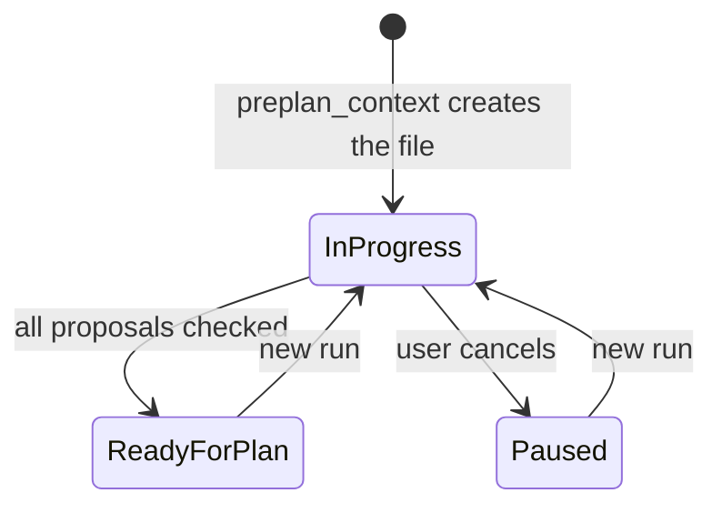
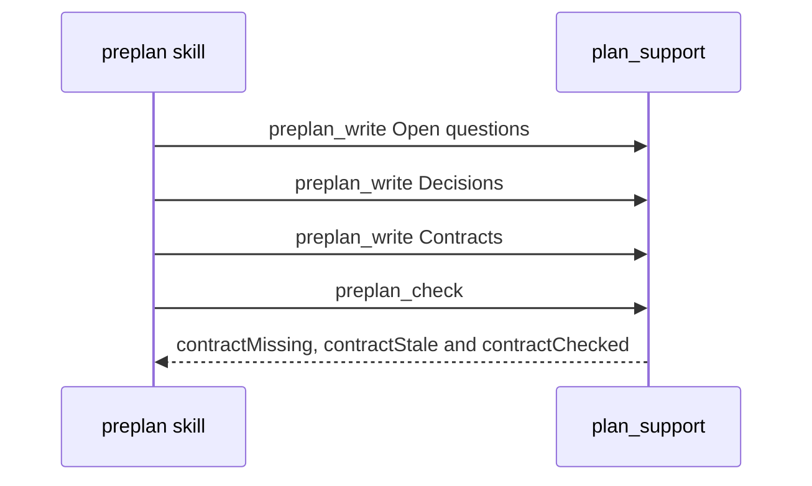

# skill-preplan Specification

## Purpose
Lets a user shape an idea into one topic file, with each proposal checked against the plan guardrails, before `/sdlc:plan` reads that file.

## Requirements

### Requirement: Topic file start
The `/sdlc:preplan` skill SHALL get the plan guardrails and the topic file path from `plan_support` action `preplan_context`, and SHALL NOT start a plan run.

#### Scenario: First run for a topic
- **WHEN** the user runs `/sdlc:preplan auth flow` on 2026-10-12 (UTC) and `.sdlc-v2/preplan/` holds no `auth-flow.md` and no `YYYY-MM-DD-auth-flow.md`
- **THEN** the skill calls `plan_support` with `action: "preplan_context"` and `topic: "auth flow"`
- **AND** `.sdlc-v2/preplan/2026-10-12-auth-flow.md` exists with status `in progress` and a `**Started:**` line
- **AND** no new `plan-*` state file exists in `.sdlc-v2/runs/`

#### Scenario: Run again for a topic
- **WHEN** the user runs `/sdlc:preplan auth flow` and `.sdlc-v2/preplan/auth-flow.md` exists from before dated names
- **THEN** the skill continues `auth-flow.md`
- **AND** no dated file is created

#### Scenario: Tool error
- **WHEN** `preplan_context` returns an error
- **THEN** the skill prints the error and stops

#### Scenario: Two matching topic files
- **WHEN** `preplan_context` returns the error for two topic files that match
- **THEN** the skill prints the error's `## Do this` text and stops

### Requirement: One question at a time
The skill SHALL ask one question in each AskUserQuestion call and SHALL update the topic file after each answer.

- Questions ask about function and effect, not about code. The one exception is the contract shapes of `## Contracts`: URLs, payload fields, data fields, config keys and message fields.
- A vague answer gets one follow-up question.

#### Scenario: Answer recorded
- **WHEN** the user answers a question with a new decision
- **THEN** the topic file `## Decisions` table has one more row before the next question

#### Scenario: Contract shape question
- **WHEN** the skill asks the contract question for a live proposal
- **THEN** the question asks for the exact URL, payload fields, data fields, config keys or message fields of that proposal

### Requirement: Guardrail check per proposal
The skill SHALL check each live proposal against each plan guardrail at each Step 4, SHALL record a kept or dropped result as a note in the Reason cell of the `## Decisions` row, and SHALL call `plan_support` action `preplan_check` once at the end of Step 4.

- A live proposal is a `## Decisions` row whose Decision cell starts with neither `Dropped:` nor `Moved:`.
- The skill writes no other check text into the topic file: no basis, no pass list, no table.
- The skill never writes the `**Guardrail check:**` line itself.

| Conflict | Topic file record | Count |
|---|---|---|
| breaks an `error` guardrail after one rework | `Dropped:` at the start of the Decision cell, `Dropped by: <ids>.` at the end of the Reason cell | `droppedCount` |
| breaks only `warning` guardrails, user keeps it | `Kept with warning: <ids>.` at the end of the Reason cell | `keptCount` |
| guardrails loaded, no conflict | none; a kept note is deleted | `passCount` |
| guardrails unavailable | none; kept notes stay | `keptCount` with a kept note, else `passCount` |

#### Scenario: Error guardrail conflict
- **WHEN** a proposal still breaks an `error` guardrail `no-ci-bypass` after one rework
- **THEN** its Decision cell starts with `Dropped:`
- **AND** its Reason cell ends with `Dropped by: no-ci-bypass.`

#### Scenario: Warning guardrail conflict
- **WHEN** a proposal breaks a `warning` guardrail and its Reason cell has no kept note for that guardrail
- **THEN** the skill shows the reason and asks the user to keep, rework or cancel

#### Scenario: Kept proposal on a later check
- **WHEN** a proposal breaks only the `warning` guardrail `kiss` and its Reason cell ends with `Kept with warning: kiss.`
- **THEN** the skill asks no question about that proposal

#### Scenario: Check line written
- **WHEN** Step 4 ends with 6 pass, 1 kept and 0 dropped proposals
- **THEN** the skill calls `plan_support({ action: "preplan_check", topic: "<topic>", passCount: 6, keptCount: 1, droppedCount: 0 })`
- **AND** the skill reads the topic file again before its next edit
- **AND** the topic file has no `## Guardrail check` section

#### Scenario: Check call fails
- **WHEN** `preplan_check` returns an error
- **THEN** the skill prints the error's `## Do this` text and goes to the cancel step
- **AND** the status is `paused`

### Requirement: Flow diagrams with a text twin
The skill SHALL write a before and after Mermaid diagram under `## Flows` for each proposal that changes a flow, and SHALL write a numbered text list of the same steps below each diagram.

#### Scenario: Flow change
- **WHEN** a proposal changes how a user starts a plan
- **THEN** `## Flows` has a Mermaid diagram and a numbered list with the same steps

#### Scenario: No flow change
- **WHEN** no proposal changes a flow
- **THEN** `## Flows` has the line `No flow change.`

### Requirement: Topic status
The preplan skill SHALL change the topic file status only as the diagram shows. The dashboard Preplans tab SHALL set any of the three statuses that the user picks, outside this skill.

#### Scenario: Cancel
- **WHEN** the user cancels during a question
- **THEN** the status is `paused` and the file stays

#### Scenario: Status set from the dashboard
- **WHEN** the user picks `paused` in the dashboard status menu of a topic file with status `ready for plan`
- **THEN** the topic file has `**Status:** paused`

### Requirement: Handoff to plan
When the topic is ready, the skill SHALL set the status `ready for plan` with `preplan_write`, SHALL offer Start plan now, Start a new idea and Stop, and SHALL keep the status `ready for plan` on each of these paths.

#### Scenario: User starts the plan
- **WHEN** the user picks Start plan now and `readyTopicFiles` holds only this file
- **THEN** the skill runs `/sdlc:plan` with the topic file path in double quotes in the same session

#### Scenario: Several ready topic files
- **WHEN** the user picks Start plan now and `readyTopicFiles` holds 3 paths
- **THEN** the skill asks which paths to include, with this file first
- **AND** the skill runs `/sdlc:plan` with each picked path in double quotes, in option order

#### Scenario: Start a new idea
- **WHEN** the user picks Start a new idea and answers `export flow`
- **THEN** the skill runs `/sdlc:preplan export flow` in the same session
- **AND** this topic file keeps the status `ready for plan`

#### Scenario: Plan skill fails
- **WHEN** the plan skill stops with an error
- **THEN** the skill prints the error and tells the user to run `/sdlc:plan` with the picked paths

### Requirement: Open questions only when open
The skill SHALL keep a `## Open questions` section in the topic file only while at least one question has no answer.

- The skill adds the section after `## Decisions` with the first bullet.
- The skill deletes the whole section with the last bullet.

#### Scenario: First open question
- **WHEN** the topic file has no `## Open questions` section and an answer opens a new question
- **THEN** the file has a `## Open questions` section after `## Decisions` with one bullet

#### Scenario: Last question closed
- **WHEN** an answer closes the last bullet of `## Open questions`
- **THEN** the file has no `## Open questions` section

#### Scenario: Run again with no open question
- **WHEN** the user runs `/sdlc:preplan auth flow` again and the topic file has no `## Open questions` section
- **THEN** the skill prints `No open questions.`

### Requirement: Old topic file conversion
When the skill continues a topic file that has a `## Guardrail check` section, the skill SHALL move each kept and dropped result into a Reason cell note, and SHALL then delete the section.

- A note that the Reason cell already holds is not added again.
- The skill deletes the old section only after it writes every note.
- An empty `## Open questions` section is also deleted.

#### Scenario: Old kept row
- **WHEN** the old table has the row `| 2 | kiss | warning | kept — kiss |`
- **THEN** the Reason cell of `## Decisions` row 2 ends with `Kept with warning: kiss.`
- **AND** the file has no `## Guardrail check` section

#### Scenario: Conversion runs again
- **WHEN** a run stops after the notes are written but before the table is deleted, and the user runs the skill again
- **THEN** each Reason cell holds the note one time only

### Requirement: Topic file writes through the tool
The skill SHALL change the topic file only through the `plan_support` actions `preplan_context`, `preplan_check` and `preplan_write`, and SHALL NOT use a file edit or a file write on it.

#### Scenario: Plan mode is active
- **WHEN** the user runs `/sdlc:preplan auth flow` while plan mode is active and answers a question
- **THEN** the topic file holds the answer before the next question

#### Scenario: Refused body
- **WHEN** `preplan_write` refuses the body of one answer for the first time
- **THEN** the skill fixes the body and sends the call again

#### Scenario: Third refusal
- **WHEN** `preplan_write` refuses the body of one answer three times
- **THEN** the skill prints the error and goes to the cancel step
- **AND** the status is `paused`

### Requirement: No plan warning for a preplan session
The stop hook SHALL NOT print `Plan presented but plan was not invoked` when the transcript, in its first 64 MiB, holds a `/sdlc:preplan` command record or a Skill call for `sdlc:preplan`.

#### Scenario: Preplan session in plan mode
- **WHEN** the transcript holds `<command-name>/sdlc:preplan</command-name>` and later `Plan mode is active`, and no plan state file exists
- **THEN** the stop hook prints no warning

#### Scenario: No preplan record
- **WHEN** the transcript holds `Plan mode is active` and no preplan record, and no plan state file exists
- **THEN** the stop hook prints the warning

#### Scenario: Transcript cannot be read
- **WHEN** the transcript path is a folder and no plan state file exists
- **THEN** the stop hook prints no warning, because an unreadable transcript gives no evidence of plan mode

### Requirement: Check against OpenSpec at the handoff
When the project has `openspec/config.yaml`, the preplan handoff question SHALL offer `Check against OpenSpec`. The option SHALL run `/sdlc:verify-requirements --topic <topic>`, then ask the handoff question again.

#### Scenario: OpenSpec project
- **WHEN** `openspec/config.yaml` exists and the topic is ready for plan
- **THEN** the handoff question has 4 options, one of them `Check against OpenSpec`

#### Scenario: No OpenSpec
- **WHEN** `openspec/config.yaml` does not exist
- **THEN** the handoff question has 3 options

#### Scenario: Check stops with an error
- **WHEN** the check stops with an error
- **THEN** the skill prints the error and asks the handoff question again

### Requirement: Contract answer for each live proposal
In Step 3, the skill SHALL ask for one contract answer for each live proposal that has none, and SHALL send the full new `## Contracts` body with `preplan_write` after each contract answer.

- A contract answer is a label line that lists the `#` value of the proposal, or that `#` value in the one `No contract:` line.
- The skill asks this after a missing `## Flows` entry and before the next proposal, lowest `#` value first.

#### Scenario: Contract question
- **WHEN** `## Flows` has an entry and the live proposals 1 and 2 have no contract answer
- **THEN** the next question restates proposal 1 and asks which endpoints, data shapes, config keys or flags, and messages it adds or changes, with the exact shape of each
- **AND** the options are give the shapes, `no contract`, `done` and `cancel`

#### Scenario: Block answer
- **WHEN** the user gives the shape of `POST /api/topics` for proposal 2
- **THEN** the skill calls `preplan_write` with `section: "Contracts"` and a body that holds `**#2 Endpoint: POST /api/topics**` above an `http` code fence
- **AND** the body keeps each other block and the `No contract:` line

#### Scenario: No contract answer
- **WHEN** the user answers `no contract` for proposal 3 and `## Contracts` holds `No contract: #5.`
- **THEN** the new `## Contracts` body holds `No contract: #3, #5.`

#### Scenario: Answer moves an id to the other form
- **WHEN** `## Contracts` holds `No contract: #3, #5.` and the user gives a shape for proposal 3
- **THEN** the new body holds the block of proposal 3 and `No contract: #5.`

#### Scenario: One answer changes Decisions and Contracts
- **WHEN** one answer changes `## Decisions` and `## Contracts`
- **THEN** the skill sends the Decisions call before the Contracts call

#### Scenario: Stop between the two calls
- **WHEN** the Decisions call succeeds, the session stops before the Contracts call, and the user runs `/sdlc:preplan` with the same topic again
- **THEN** Step 3 asks the contract question for the proposal with no contract answer

### Requirement: Contract block forms
Each `## Contracts` block SHALL have one label line `**#<id>[, #<id>] <Kind>: <name>**` above a code fence or a table in the form of its kind.

| Kind | Body |
|---|---|
| `Endpoint` (HTTP or RPC call) | `http` fence: method, URL, request, each response |
| `Data` (stored shape) | table `Field \| Type \| Change \| Notes` |
| `Config` (key, flag, env var) | table `Op \| Key \| Type \| Default \| Values` |
| `Message` (event or tool fields) | `json` fence with every field |

#### Scenario: Data block
- **WHEN** proposal 3 adds a `topics` table with the fields `id` and `owner`
- **THEN** the block is the label line `**#3 Data: topics table**` above a table with the header `| Field | Type | Change | Notes |`
- **AND** each Change cell is `+`, `−` or `~`

#### Scenario: One block for two proposals
- **WHEN** proposals 1 and 3 change the same table
- **THEN** one block has the label line `**#1, #3 Data: topics table**`

#### Scenario: Note about a block
- **WHEN** a block needs the note `Errors are 4xx.`
- **THEN** the skill writes the note inside the code fence or in a table cell, not as a line of its own

### Requirement: Contract blocks in the guardrail check
At each Step 4, the skill SHALL check each live proposal together with its `## Contracts` blocks against each plan guardrail.

#### Scenario: Contract block in the check
- **WHEN** proposal 3 is live and `## Contracts` holds the block `**#3 Config: preplan.maxTopics**`
- **THEN** the Step 4 check of proposal 3 checks that block against each guardrail together with the proposal

### Requirement: Step 4 write order
At the end of Step 4, the skill SHALL send `preplan_write` for `## Open questions`, then for `## Decisions`, then for `## Contracts`, then `preplan_check`.

Step 4 calls of the preplan skill, in order:

#### Scenario: Contracts call fails after the Decisions call
- **WHEN** the Decisions call drops proposal 2 and the Contracts call then fails
- **THEN** the next `preplan_check` lists `#2` in `contractStale`
- **AND** the next Contracts write that keeps another block removes `#2`

#### Scenario: Decisions call fails
- **WHEN** the Decisions call of Step 4 fails
- **THEN** the skill sends no Contracts call

### Requirement: Contracts prune at Step 4
After the `## Decisions` write of Step 4, the skill SHALL remove from `## Contracts` each `#` value whose row is not live, and SHALL send the pruned body in one `preplan_write` call.

- A block whose label line then lists no `#` value is deleted, and so is a `No contract:` line that lists none.
- A rework that changes a shape writes the new shape into its block in the same body.
- When the pruned body is blank or unchanged, the skill sends no Contracts call.

#### Scenario: Block of a dropped proposal
- **WHEN** proposal 2 is dropped in this pass and `## Contracts` holds `**#2 Endpoint: POST /x**` and its fence
- **THEN** the pruned body has no such block

#### Scenario: Shared label
- **WHEN** proposal 2 is dropped and `## Contracts` holds `**#1, #2 Data: topics**` and its table
- **THEN** the pruned body holds `**#1 Data: topics**` and the same table

#### Scenario: No-contract line
- **WHEN** proposal 2 is dropped and `## Contracts` holds `No contract: #2, #4.`
- **THEN** the pruned body holds `No contract: #4.`

#### Scenario: Blank prune result
- **WHEN** proposal 2 is dropped and `## Contracts` holds only `No contract: #2.`
- **THEN** the skill sends no Contracts call
- **AND** `preplan_check` lists `#2` in `contractStale`

#### Scenario: Rework changes a shape
- **WHEN** a rework changes the URL of the endpoint of proposal 1
- **THEN** the pruned body holds the new URL in the block of proposal 1

### Requirement: Contract gate before the handoff
Step 4 SHALL go to Step 5 or to the soft gate only when `preplan_check` returns `contractChecked` as true and `contractMissing` as `(none)`, and SHALL go back to Step 3 when `contractMissing` lists 1 or more `#` values.

- The first matching route row applies, so the cut question comes first.
- `contractStale` routes nothing. The skill tells the user its ids in one line.

#### Scenario: Missing contract answer
- **WHEN** `final` is set, 1 proposal is live, `## Flows` has an entry and `contractMissing` lists `#3`
- **THEN** the skill goes back to Step 3
- **AND** the skill tells the user that proposal 3 has no contract answer, then asks about it

#### Scenario: Each contract answer present
- **WHEN** `final` is set, 1 proposal is live, `## Flows` has an entry, `contractMissing` is `(none)` and `emptySections` is `(none)`
- **THEN** the skill goes to Step 5

#### Scenario: Empty sections remain
- **WHEN** `final` is set, 1 proposal is live, `## Flows` has an entry, `contractMissing` is `(none)` and `emptySections` lists `## Risk if wrong`
- **THEN** the skill goes to the soft gate

#### Scenario: Cut question first
- **WHEN** `final` is set, 2 proposals are live, the file has no `Smallest cut:` line and `contractMissing` lists `#2`
- **THEN** the skill goes to Step 3 with the cut question

#### Scenario: Stale ids
- **WHEN** `contractStale` lists `#5`
- **THEN** the skill prints one line that names `#5`
- **AND** the route is the same as with `contractStale` `(none)`

### Requirement: Contract check that did not run
When `preplan_check` returns `contractChecked` as false, the skill SHALL repair the cause that `next` names with tool calls, SHALL call `preplan_check` once more, and SHALL go to the cancel step when `contractChecked` is still false.

#### Scenario: Open fence at the check
- **WHEN** `final` is set, 1 proposal is live, `## Flows` has an entry and `preplan_check` returns `contractChecked` false because a code fence is still open
- **THEN** the skill runs the open-fence repair and calls `preplan_check` again
- **AND** the skill does not go to Step 5 or the soft gate while `contractChecked` is false
