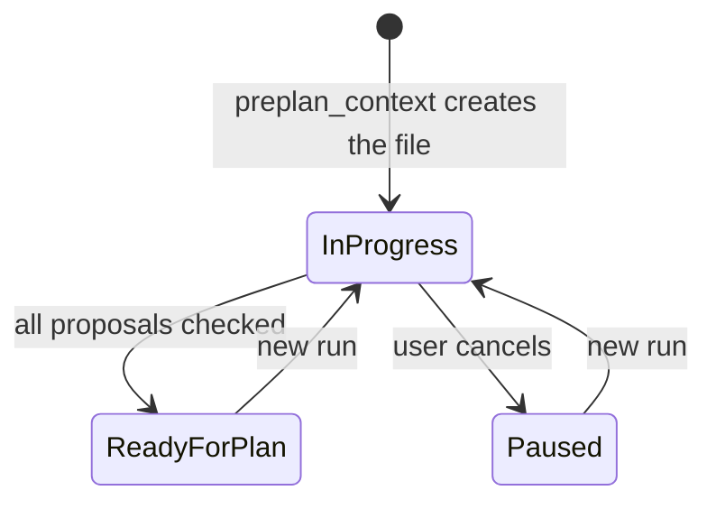

# skill-preplan Specification

## Purpose
Lets a user shape an idea into one topic file, with each proposal checked against the plan guardrails, before `/sdlc:plan` reads that file.

## Requirements

### Requirement: Topic file start
The `/sdlc:preplan` skill SHALL get the plan guardrails and the topic file path from `plan_support` action `preplan_context`, and SHALL NOT start a plan run.

#### Scenario: First run for a topic
- **WHEN** the user runs `/sdlc:preplan auth flow` on 2026-10-12 (UTC) and `.sdlc-v2/preplan/` holds no `auth-flow.md` and no `YYYY-MM-DD-auth-flow.md`
- **THEN** the skill calls `plan_support` with `action: "preplan_context"` and `topic: "auth flow"`
- **AND** `.sdlc-v2/preplan/2026-10-12-auth-flow.md` exists with status `in progress` and a `**Started:**` line
- **AND** no new `plan-*` state file exists in `.sdlc-v2/runs/`

#### Scenario: Run again for a topic
- **WHEN** the user runs `/sdlc:preplan auth flow` and `.sdlc-v2/preplan/auth-flow.md` exists from before dated names
- **THEN** the skill continues `auth-flow.md`
- **AND** no dated file is created

#### Scenario: Tool error
- **WHEN** `preplan_context` returns an error
- **THEN** the skill prints the error and stops

#### Scenario: Two matching topic files
- **WHEN** `preplan_context` returns the error for two topic files that match
- **THEN** the skill prints the error's `## Do this` text and stops

### Requirement: One question at a time
The skill SHALL ask one question in each AskUserQuestion call and SHALL update the topic file after each answer.

- Questions ask about function and effect, not about code.
- A vague answer gets one follow-up question.

#### Scenario: Answer recorded
- **WHEN** the user answers a question with a new decision
- **THEN** the topic file `## Decisions` table has one more row before the next question

### Requirement: Guardrail check per proposal
The skill SHALL check each live proposal against each plan guardrail at each Step 4, SHALL record a kept or dropped result as a note in the Reason cell of the `## Decisions` row, and SHALL call `plan_support` action `preplan_check` once at the end of Step 4.

- A live proposal is a `## Decisions` row whose Decision cell starts with neither `Dropped:` nor `Moved:`.
- The skill writes no other check text into the topic file: no basis, no pass list, no table.
- The skill never writes the `**Guardrail check:**` line itself.

| Conflict | Topic file record | Count |
|---|---|---|
| breaks an `error` guardrail after one rework | `Dropped:` at the start of the Decision cell, `Dropped by: <ids>.` at the end of the Reason cell | `droppedCount` |
| breaks only `warning` guardrails, user keeps it | `Kept with warning: <ids>.` at the end of the Reason cell | `keptCount` |
| guardrails loaded, no conflict | none; a kept note is deleted | `passCount` |
| guardrails unavailable | none; kept notes stay | `keptCount` with a kept note, else `passCount` |

#### Scenario: Error guardrail conflict
- **WHEN** a proposal still breaks an `error` guardrail `no-ci-bypass` after one rework
- **THEN** its Decision cell starts with `Dropped:`
- **AND** its Reason cell ends with `Dropped by: no-ci-bypass.`

#### Scenario: Warning guardrail conflict
- **WHEN** a proposal breaks a `warning` guardrail and its Reason cell has no kept note for that guardrail
- **THEN** the skill shows the reason and asks the user to keep, rework or cancel

#### Scenario: Kept proposal on a later check
- **WHEN** a proposal breaks only the `warning` guardrail `kiss` and its Reason cell ends with `Kept with warning: kiss.`
- **THEN** the skill asks no question about that proposal

#### Scenario: Check line written
- **WHEN** Step 4 ends with 6 pass, 1 kept and 0 dropped proposals
- **THEN** the skill calls `plan_support({ action: "preplan_check", topic: "<topic>", passCount: 6, keptCount: 1, droppedCount: 0 })`
- **AND** the skill reads the topic file again before its next edit
- **AND** the topic file has no `## Guardrail check` section

#### Scenario: Check call fails
- **WHEN** `preplan_check` returns an error
- **THEN** the skill prints the error's `## Do this` text and goes to the cancel step
- **AND** the status is `paused`

### Requirement: Flow diagrams with a text twin
The skill SHALL write a before and after Mermaid diagram under `## Flows` for each proposal that changes a flow, and SHALL write a numbered text list of the same steps below each diagram.

#### Scenario: Flow change
- **WHEN** a proposal changes how a user starts a plan
- **THEN** `## Flows` has a Mermaid diagram and a numbered list with the same steps

#### Scenario: No flow change
- **WHEN** no proposal changes a flow
- **THEN** `## Flows` has the line `No flow change.`

### Requirement: Topic status
The preplan skill SHALL change the topic file status only as the diagram shows. The dashboard Preplans tab SHALL set any of the three statuses that the user picks, outside this skill.

#### Scenario: Cancel
- **WHEN** the user cancels during a question
- **THEN** the status is `paused` and the file stays

#### Scenario: Status set from the dashboard
- **WHEN** the user picks `paused` in the dashboard status menu of a topic file with status `ready for plan`
- **THEN** the topic file has `**Status:** paused`

### Requirement: Handoff to plan
When the topic is ready, the skill SHALL ask whether to start `/sdlc:plan <preplanFile>` now, and SHALL keep the status `ready for plan` when the user stops or the plan skill fails.

#### Scenario: User starts the plan
- **WHEN** the user picks start
- **THEN** the skill runs `/sdlc:plan` with the topic file path in the same session

#### Scenario: Plan skill fails
- **WHEN** the plan skill stops with an error
- **THEN** the skill prints the error and tells the user to run `/sdlc:plan <preplanFile>`

### Requirement: Open questions only when open
The skill SHALL keep a `## Open questions` section in the topic file only while at least one question has no answer.

- The skill adds the section after `## Decisions` with the first bullet.
- The skill deletes the whole section with the last bullet.

#### Scenario: First open question
- **WHEN** the topic file has no `## Open questions` section and an answer opens a new question
- **THEN** the file has a `## Open questions` section after `## Decisions` with one bullet

#### Scenario: Last question closed
- **WHEN** an answer closes the last bullet of `## Open questions`
- **THEN** the file has no `## Open questions` section

#### Scenario: Run again with no open question
- **WHEN** the user runs `/sdlc:preplan auth flow` again and the topic file has no `## Open questions` section
- **THEN** the skill prints `No open questions.`

### Requirement: Old topic file conversion
When the skill continues a topic file that has a `## Guardrail check` section, the skill SHALL move each kept and dropped result into a Reason cell note, and SHALL then delete the section.

- A note that the Reason cell already holds is not added again.
- The skill deletes the old section only after it writes every note.
- An empty `## Open questions` section is also deleted.

#### Scenario: Old kept row
- **WHEN** the old table has the row `| 2 | kiss | warning | kept — kiss |`
- **THEN** the Reason cell of `## Decisions` row 2 ends with `Kept with warning: kiss.`
- **AND** the file has no `## Guardrail check` section

#### Scenario: Conversion runs again
- **WHEN** a run stops after the notes are written but before the table is deleted, and the user runs the skill again
- **THEN** each Reason cell holds the note one time only
