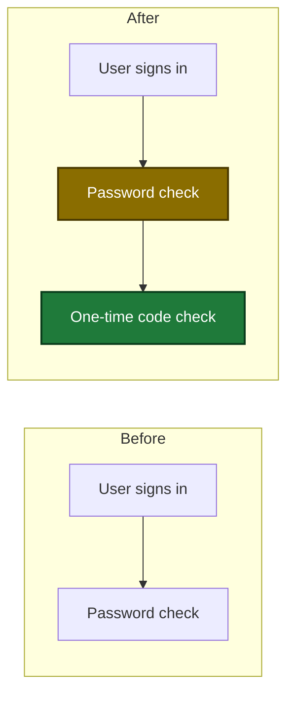

# Preplan (SDLC)

Preplan turns an idea into one topic file that `/sdlc:plan` can read as its
requirements file. The skill holds the dialogue and the judgement. The
`plan_support` tool holds the file I/O with known content: `preplan_context`
loads the plan guardrails and creates the topic file with its skeleton, or adds
the absent section headings to an existing file, `preplan_check` writes the
`**Guardrail check:**` line into it and returns its empty sections, and
`preplan_write` checks and writes one section body or the Status line. The skill
changes the topic file only through these three actions, so it works in plan
mode. The topic file is in
the main worktree, so it is the same in every worktree. The tool returns its
absolute path as `preplanFile`.

**Announce at start:** "I'm using preplan (sdlc v{sdlc_version})." - extract the version from the `sdlc:` line in the session-start system-reminder. If no version is in context, omit the parenthetical.

**Communication style:** Follow the `sdlc communication style` block in session context for every explanation, status line, summary, and AskUserQuestion text in this skill.

**Decision-framing rule:** Before each AskUserQuestion call, restate the facts the user needs: what is decided, what the choice changes, and the effect of each option.

---

## Topic file

The tool writes the skeleton once: a `# Preplan: <topic>` heading, a `**Status:** in progress` line, a `**Started:** <UTC time>` line, and the sections below in this order, except `## Open questions`. When the file exists, the tool adds each absent skeleton heading (`## Goal` to `## Decisions`) in this order and returns them as `addedSections`. The skill never writes the skeleton, never creates the file, never adds a skeleton heading, and never changes the Started line. `## Open questions` is the one heading that `preplan_write` adds, when the skill sends it, and only when a question is open.

When Step 4 reaches the `preplan_check` call, the tool writes one `**Guardrail check:**` line under the Started line. It shows the guardrail count, the proposal counts and the UTC time of the check. When the guardrails are unavailable, the line ends with `Guardrails unavailable: <warning>.` The skill never writes that line. A cancel in Step 4 and a `preplan_check` error write no line.

| Section | Content |
|---|---|
| `## Goal` | one or two sentences: the result the user wants |
| `## Problem and benefit` | the root problem in one sentence, who gains, the measure with its baseline, and the cost of no change |
| `## Users and effect` | who uses the change, what changes for them, what fails today |
| `## Risk if wrong` | who or what fails if the change has a defect |
| `## Non-goals` | what the change does not build, one bullet each. A refused scope option is a bullet `Offered, not picked: <option>.` When the user says that the change excludes nothing, the line `None stated.` |
| `## Flows` | one before/after Mermaid diagram with its text twin for each flow that a proposal changes, or the line `No flow change.` |
| `## Decisions` | a table with the columns `#`, `Decision` and `Reason`, one row for each proposal. A proposal is one row of this table, except a row whose `Decision` cell starts with `Moved:` (see Step 4). The `#` value of a row never changes and is never used again. The skill never deletes a row, so the next unused `#` value is one more than the highest `#` in the table. A Reason cell can end with `Kept with warning: <ids>.` or `Dropped by: <ids>.` (see Step 4). No other check text goes in a Reason cell. Under the table, one line `Smallest cut: #<id>, #<id>.` or `Smallest cut: all.` holds the answer to the cut question (see Step 3). The line is not a row. Write it under the last row, before `## Open questions` |
| `## Open questions` | only when at least one question has no answer: one bullet for each question. `preplan_write` adds the section after `## Decisions` when the skill sends the first bullet. It deletes the whole section when the skill sends an empty `content` after the last bullet goes |

### Topic file status

Each status change in this skill matches one row of this table. The skill makes no other status change. The user can set any of the three statuses outside this skill. Treat a status that the file holds the same way, whoever set it: Step 2 of a new run sets `in progress`.

| From | Event | To |
|---|---|---|
| no file | `preplan_context` creates the file | `in progress` |
| `in progress` | Step 5 | `ready for plan` |
| `in progress` | cancel | `paused` |
| `paused` or `ready for plan` | Step 2 on a new run | `in progress` |

---

## Flow

| Step | Action | Next |
|---|---|---|
| 0 | Announce. Take the topic from the argument, or ask one question for it | Step 1. On cancel: end. No file exists yet, so nothing changes |
| 1 | Call `plan_support({ action: "preplan_context", topic: "<topic>" })` | Step 2. On a tool error: print it, then stop |
| 2 | Read `preplanFile`. If `preplanCreated` is false, call `preplan_write` with `topicStatus: "in progress"`, convert an old-form file with `preplan_write`, and list the open questions, if any | Step 3. On a tool error: print it, then stop |
| 3 | Ask one question with AskUserQuestion, from the first gap. Challenge a vague answer with one follow-up question. Record each refused scope option under `## Non-goals`. Call `preplan_write` with the full new body of each changed section. If a proposal changes a flow, send a before/after Mermaid diagram and its text twin as the `## Flows` body | Step 3 route table. On a tool error: the error table |
| 4 | Check every live proposal against each guardrail. Write the kept and drop notes and prune the `Smallest cut:` line in one `preplan_write` call for `## Decisions`. Unless the user cancels, call `preplan_check` with the counts, then read `preplanFile` again. Keep `emptySections` | Step 4 route table: Step 5, the soft gate, Step 3 or cancel. On a tool error: the error table |
| 5 | Reached from a Step 4 pass with no empty section, or from the soft gate. Call `plan_support({ action: "preplan_write", topic: "<topic>", topicStatus: "ready for plan" })`. Keep `readyTopicFiles`, `readyLeftOut` and `summary`. Ask with AskUserQuestion: start the plan now, start a new idea, or stop | Step 5 route table |
| cancel | Call `plan_support({ action: "preplan_write", topic: "<topic>", topicStatus: "paused" })`. Keep the file | end |

Every exit state names its next instruction:

| Exit state | Where | Next instruction |
|---|---|---|
| cancelled before the file exists | Step 0 | end. Make no tool call |
| tool error | Step 1 or Step 2 | print the error's `## Do this` text as it is, then stop. Do not retry |
| tool error that is not a rule refusal and not a first `section ... not found` error (see the error table) | Step 3, Step 4 or Step 5 | print the error's `## Do this` text as it is, then go to the cancel step |
| third refusal for one call site | Step 3 or Step 4 | print the error, then go to the cancel step |
| cancel-step write fails | cancel | print the error's `## Do this` text as it is, then end |
| cancelled during the dialogue | Step 3 or Step 4 | go to the cancel step: set status `paused`, keep the file, end |
| cancelled at the soft gate | Step 4 | go to the cancel step: set status `paused`, keep the file, end |
| tool error at the soft gate | Step 4 | print the error's `## Do this` text as it is, then go to the cancel step |
| user stops at the handoff | Step 5 | end. Status stays `ready for plan` |
| plan skill ends | Step 5 | end |
| plan skill stops with an error | Step 5 | print the error. Status stays `ready for plan`. Tell the user to run `/sdlc:plan` with the picked paths. End |
| new idea starts | Step 5 | the new preplan run continues in this session. This file stays `ready for plan`, unless the topic name matches this file; the new run then sets it to `in progress` (Step 2) |
| new idea cancelled | Step 5 | end. Status stays `ready for plan` |

### Topic file writes

Every change of the topic file is a `plan_support` call. The skill sends the full new body of one section, or a status, or both:

```
plan_support({ action: "preplan_write", topic: "<topic>", section: "<section>", content: "<full new body>" })
plan_support({ action: "preplan_write", topic: "<topic>", topicStatus: "<status>" })
```

The tool changes each CR LF in `content` to LF and removes the final line ends before it checks the body. It refuses a body over 65536 bytes (rule P1) or a body that breaks another format rule. An empty `content` deletes the `## Open questions` or the `## Guardrail check` section. When the file has no Status line, a `topicStatus` call inserts one. The error text of each refusal starts with `preplan_write: ` and names the rule id, for example `preplan_write: Section "Decisions" breaks rule P5: ...`. A rule refusal writes nothing. A second call with the same input gives the same file as the first call, so a new run can repeat a call that an earlier run made.

After each `preplan_write` call and each `preplan_check` call, read `summary`. When it names extra `## ` headings, extra Status lines or extra Guardrail check lines that stay in the file, tell the user which lines stay. Tell the user to delete them by hand: no preplan action removes them. When it says that a code fence is still open, tell the user. The next Step 4 pass repairs the fence (see Step 4). A write to a heading that the fence hides before that pass follows the `section ... not found` row of the error table.

Steps that call `preplan_write`:

| Step | Call | On success |
|---|---|---|
| 2 | `topicStatus: "in progress"` when `preplanCreated` is false. Then one old-form call for each old-form condition that holds (1 to 3 calls, see Step 2), only for an old-form file | Step 3 |
| 3 | `section`, `content` after each answer that changes a section | next question |
| 4, a `Moved:` row in the pass | `section: "Open questions"` with the question of the row, before the Decisions call | the Decisions call |
| 4 | `section: "Decisions"` for notes and the prune, then `preplan_check` | Step 4 route table |
| 4, open-fence repair | `section` of the last section with the fence closed, when `preplan_context` names no closing fence line. Then `section: "Open questions"` when the fence hid that heading | read `preplanFile` again, then the Step 4 route table |
| 5 | `topicStatus: "ready for plan"` | Step 5 route table |
| cancel | `topicStatus: "paused"` | end |

Errors of a `plan_support` call (one outcome for each input):

| Error | Step | Next |
|---|---|---|
| a refusal that names a rule P1-P11, the 1st or 2nd for this call site | 3, 4 | fix the body and send the call again |
| a refusal that names a rule P1-P11, the 3rd for this call site | 3, 4 | print the error, then the cancel step |
| a `section "<name>" not found` error, the 1st for this call site | 3, 4 | follow its `## Do this` text once. The text ends with the call to send again: send it once, and do not send it a second time. Then read `preplanFile` again |
| a `section "<name>" not found` error, the 2nd for this call site | 3, 4 | print the `## Do this` text, then the cancel step |
| any other error | 2 | print the `## Do this` text, then stop |
| any other error | 3, 4, 5 | print the `## Do this` text, then the cancel step |
| any error | cancel | print the `## Do this` text, then end. The status stays as the file holds it |

Refusal counter scope: one call site is one answer in Step 3, or one Step 4 pass. The counter starts at 0 again after a success.

---

## Step 0: Announce and take the topic

Print the announce line. When the argument holds a topic, use it as the topic. When the argument is empty, ask one AskUserQuestion: "What is the short name of the topic? It becomes part of the topic file name." Offer a cancel option.

- The user gives a topic: go to Step 1.
- The user cancels: end. No file exists yet, so nothing changes.

## Step 1: Load the guardrails and the topic file

Make exactly one call here. Only the soft gate (see Soft gate routes), the Step 4 open-fence repair and the `section ... not found` row of the error table can make one more `preplan_context` call:

```
plan_support({ action: "preplan_context", topic: "<topic>" })
```

Never call `plan_prepare`. It starts a plan run and prunes other runs.

| Result | Next |
|---|---|
| success | keep `guardrails`, `preplanFile`, `preplanCreated`, `addedSections` and `summary`. Go to Step 2 |
| tool error (bad topic, two topic files that match, a folder that cannot be listed or holds too many names, a failed create, a link or another file that is not regular, a file over 8 MiB or a repair that would make it larger, or a failed read or heading write) | print the error's `## Do this` text as it is, then stop. Make no other call |

When the `summary` holds `Warning: <warning>.`, the guardrails are unavailable. The dialogue continues. At Step 4, `preplan_check` loads the guardrails again and writes its own warning into the check line. If the two loads differ, the check line shows the result of the second load.

## Step 2: Read the topic file

Read `preplanFile`. The topic file is the only state of this skill, so a new run of the skill continues from it. In an existing file, `preplan_context` already added each absent skeleton heading. Each added section is empty, so Step 3 finds it as a gap. When `addedSections` lists headings, tell the user which headings the tool added. When `summary` says that the tool added a closing fence line, tell the user that too.

| `preplanCreated` | Action |
|---|---|
| `true` | the file holds the skeleton. Status is `in progress`. Go to Step 3 |
| `false` | call `plan_support({ action: "preplan_write", topic: "<topic>", topicStatus: "in progress" })` (status table row 4 when the status is `paused` or `ready for plan`; when it is `in progress`, the write gives the same status). Convert an old-form file (see below). If `## Open questions` exists, print its bullets to the user. Otherwise print `No open questions.` Go to Step 3 |

On a tool error in Step 2, print the error's `## Do this` text as it is, then stop. The user runs `/sdlc:preplan <topic>` again after the fix.

An old-form file has a `## Guardrail check` section, or a `## Open questions` section with no bullet. Convert it with these `preplan_write` calls, in this order. Skip a call whose condition does not hold:

1. If the file has a `## Guardrail check` section, read its rows. The `Proposal` cell holds the `#` value of a `## Decisions` row. Build the new `## Decisions` body: for each `kept — <ids>` row, end the Reason cell of that Decisions row with `Kept with warning: <ids>.`; for each `dropped — <ids>` row, end the Reason cell with `Dropped by: <ids>.` Skip a note that the Reason cell already holds. Call `plan_support({ action: "preplan_write", topic: "<topic>", section: "Decisions", content: "<new Decisions body>" })`.
2. If the file has a `## Guardrail check` section, call `plan_support({ action: "preplan_write", topic: "<topic>", section: "Guardrail check", content: "" })`. It deletes the whole section.
3. If the file has a `## Open questions` section with no bullet, call `plan_support({ action: "preplan_write", topic: "<topic>", section: "Open questions", content: "" })`. It deletes the section.

Each call removes its own condition. After call 2, the file has no `## Guardrail check` section. After call 3, the file has no empty `## Open questions` section. A run that stops during the conversion is safe to repeat: the next run sends only the calls whose condition still holds. Call 1 skips a note that the Reason cell already holds, so a repeat gives the same Decisions body.

## Step 3: Ask one question

Dialogue rules:

- Ask about function and effect: who uses it, what changes, what fails. Do not ask about code.
- Ask one question at a time, with AskUserQuestion. Offer a "done" option and a "cancel" option.
- Restate the facts before each question. Do not assume that the user remembers an earlier answer.
- Challenge a vague answer with one follow-up question. Ask for the user, the effect, or the failure case that the answer leaves out.
- Pick the next question from the first gap: `## Goal`, then `## Problem and benefit`, then `## Users and effect`, then `## Risk if wrong`, then `## Non-goals`, then the `## Open questions` bullets, then a missing `## Flows` entry, then the next proposal.
- A benefit with no measure or no baseline is vague. Ask one follow-up question for both.
- When a question offers scope options and the user picks some, add each option not picked to `## Non-goals` as `Offered, not picked: <option>.` Never record the "done" or the "cancel" option.
- Cut question: restate each live proposal with its `#` value. Ask which proposals form the smallest version that still gives value. Options: all live proposals, or a list of `#` values. Here the "done" option is the "all live proposals" option: offer it once, labelled "all (done)". The Step 3 routes say when to ask it. The cut question is not a scope question: it adds no `## Non-goals` bullet.

After each answer that changes a section, call `preplan_write` with the full new body of each changed section, before the next question. Send one call for each changed section: `plan_support({ action: "preplan_write", topic: "<topic>", section: "<section>", content: "<full new body>" })`. On an error, follow the error table (see **Topic file writes**). The new body holds:

- Write the answer into the section that it fills.
- When the user says that the change excludes nothing, write the line `None stated.` under `## Non-goals`. Delete the line when the section gets a bullet.
- After an answer to the cut question that the Step 3 routes accept, write one line under the `## Decisions` table: `Smallest cut: all.` for all live proposals or "done", else `Smallest cut: #<id>, #<id>.` with each picked `#` value in ascending order.
- Add a new question as a bullet to the `## Open questions` body. If the section does not exist, `preplan_write` adds it after `## Decisions`. Remove a bullet when an answer closes it. When the last bullet goes, send an empty `content`: `preplan_write` deletes the section.
- Add a proposal as a new row of `## Decisions`, with the next unused `#` value. The row goes above the `Smallest cut:` line, if the file has one. If that line lists ids, delete it: the cut question did not offer the new proposal, so the Step 3 and Step 4 routes ask it again. Keep a `Smallest cut: all.` line: `all` includes the new proposal.
- When a proposal changes a flow, add a before/after diagram and its text twin to the `## Flows` body (see **Mermaid rule**). When the user confirms that no flow changes, write the line `No flow change.` under `## Flows`.

Do not show a new proposal to the user as accepted before Step 4 checks it.

When an answer changes a proposal, delete the `Kept with warning:` note in its Reason cell. Step 4 then checks the changed proposal again.

Step 3 routes (one row matches each answer). The first column names the question that the user answers. A live proposal is defined in Step 4:

| Question | Answer | Next |
|---|---|---|
| any | cancel | cancel |
| the cut question | ids of live proposals, all, or "done" (means all) | write the `Smallest cut:` line, then Step 4 with `final` set |
| the cut question | any other answer, for example free text or an id that is not live | Step 3: say which ids are live, then ask the cut question again |
| not the cut question | "done", and the file has 0 live proposals | Step 3: say that the topic has no proposal, then ask for one |
| not the cut question | "done", and the file has 1 live proposal | Step 4 with `final` set |
| not the cut question | "done", 2 or more live proposals, and the file has a `Smallest cut:` line | Step 4 with `final` set |
| not the cut question | "done", 2 or more live proposals, and no `Smallest cut:` line | Step 3: ask the cut question |
| not the cut question | an answer that completes a new proposal or changes a proposal | Step 4 with `final` not set |
| not the cut question | any other answer | Step 3 |

A `Smallest cut:` line always holds 1 or more ids or `all`. Step 4 deletes a line that listed ids when the prune removes the last id of the line. Step 4 keeps an `all` line. No row matches an empty line.

## Step 4: Check the proposals against the guardrails

Check every live proposal against each guardrail in `guardrails`. A live proposal is a `## Decisions` row whose `Decision` cell starts with neither `Dropped:` nor `Moved:`. Check all live proposals each time, because the file stores no result for a pass. Each guardrail has an `id`, a `description` (the rule) and a `severity` (`error` or `warning`). A guardrail with no `severity` is `error`. Do this before the user sees the proposal as accepted.

Guardrail check rules:

| Conflict | Action | Topic file record |
|---|---|---|
| breaks one or more `error` guardrails | rework the proposal once, then check it again. If it still breaks an `error` guardrail, drop it | drop: `Dropped:` at the start of the Decision cell, `Dropped by: <ids>.` at the end of the Reason cell |
| breaks only `warning` guardrails, and the Reason cell holds `Kept with warning:` with every conflicting `id` | keep the proposal. Ask no question | none |
| breaks only `warning` guardrails, other cases | show the reason for each, ask the user once: keep, rework or cancel | keep: `Kept with warning: <ids>.` at the end of the Reason cell, in place of an earlier `Kept with warning:` note. rework: the `Moved:` rule below. cancel: the cancel step |
| guardrails loaded (the list can be empty), no conflict | none | if the Reason cell holds a `Kept with warning:` note, delete the note. The proposal counts in `passCount` |
| guardrails unavailable | continue. Keep each kept note as it is | none. A proposal with a kept note counts in `keptCount`. `preplan_check` writes the warning |

How to write the notes:

- `<ids>` lists the `id` of each guardrail that the proposal breaks, separated by commas.
- Write no other check text into the topic file: no basis, no pass list, no table.
- When the guardrails loaded and `guardrails` is empty, every live proposal is a pass. Delete each kept note.
- Rework: send a new `## Decisions` body with `preplan_write`, so that the row no longer breaks the guardrail. This body is the one `## Decisions` body of the pass (see below). Tell the user in one line what changed and which guardrails caused it.
- Drop: keep the `## Decisions` row. Start its `Decision` cell with `Dropped:`. End its Reason cell with `Dropped by: <ids>.` Tell the user which guardrails caused the drop.
- Warning conflict: ask with AskUserQuestion. Restate the proposal, each guardrail `id`, and its `description`. Options: keep the proposal as it is, rework it later, or cancel. On keep, delete an earlier `Kept with warning:` note in the Reason cell, then end the cell with `Kept with warning: <ids>.` The cell holds one kept note at most. On rework, first add the proposal as a bullet to the `## Open questions` body and send that body with `preplan_write` (`section: "Open questions"`). Skip the bullet when the `## Open questions` body already holds it. If the section does not exist, `preplan_write` adds it after `## Decisions`. Then keep the row in `## Decisions` and start its `Decision` cell with `Moved:`. A `Moved:` row is not a proposal: Step 4 does not check it, and the Step 3 and Step 4 routes do not count it. When an answer brings the proposal back, add it as a new row with the next unused `#` value. On cancel, go to the cancel step.

Prune the `Smallest cut:` line after the check and before the count. Remove from the line each `#` value whose row is not live: its `Decision` cell starts with `Dropped:` or `Moved:`. When the prune removes the last id of a line that lists ids, delete the line. With 2 or more live proposals left, the Step 4 route table then asks the cut question again. Keep a `Smallest cut: all.` line as it is. Example: proposal #2 is dropped in this pass:

| Line before | Line after | Outcome |
|---|---|---|
| `Smallest cut: #1, #2, #3.` | `Smallest cut: #1, #3.` | the other ids stay |
| `Smallest cut: #2.` | no line | the last id goes, so Step 4 deletes the line. With 2 or more live proposals left, the Step 4 route table asks the cut question again |
| `Smallest cut: all.` | `Smallest cut: all.` | no change |
| `Smallest cut: #1, #3.` | `Smallest cut: #1, #3.` | no change: the line does not list #2 |

Write the result of the check and the prune before the count. Each Step 4 pass sends one `## Decisions` body:

| Step 4 edit | Call |
|---|---|
| the question of a `Moved:` row | first, one call with `section: "Open questions"`. A failure of the Decisions call then leaves a live row and its bullet, not a `Moved:` row with no bullet |
| `Kept with warning:` notes, `Dropped:` and `Moved:` prefixes, rework rows, `Smallest cut:` prune | then one `preplan_write` call with `section: "Decisions"` |

```
plan_support({ action: "preplan_write", topic: "<topic>", section: "Decisions", content: "<full new Decisions body>" })
```

A cancel at a warning question skips both calls and goes to the cancel step. The next run checks every live proposal again. On an error, follow the error table (see **Topic file writes**). After a rule refusal, fix the body and send it again before the count.

After the check, count the rows and make one call:

- `keptCount`: live proposals whose Reason cell holds a kept note after the check.
- `passCount`: the other live proposals. Each live proposal is in one count only. When the guardrails are unavailable, no proposal was checked, so `passCount` holds unchecked proposals. The `Guardrails unavailable:` end of the check line marks these counts as not checked.
- `droppedCount`: rows whose `Decision` cell starts with `Dropped:`, from this check and earlier checks.

```
plan_support({ action: "preplan_check", topic: "<topic>", passCount: <n>, keptCount: <n>, droppedCount: <n> })
```

Then read `preplanFile` again. The tool changed the file. Keep `emptySections`: the `## ` headings of the skeleton sections (`## Goal` to `## Decisions`) that are absent or hold only blank lines (for `## Decisions`, a table with no row), or `(none)`. `## Open questions` is not a skeleton section, so it is never in the list. When `summary` says that a code fence is still open, each heading after the fence counts as absent. A fence stays open only after a change that did not go through `preplan_write`, for example a change by hand, because `preplan_write` refuses a body with an open fence (rule P3). Repair it with a tool call, never with a file edit:

1. Call `plan_support({ action: "preplan_context", topic: "<topic>" })` once more. When the fence hides a skeleton heading, the tool adds the closing fence line at the end of the file and the heading, and its `summary` names the line.
2. When the `summary` names no closing fence line, the fence is in the body of the last section. Send the full body of that section with `preplan_write`, with the fence closed. The write replaces the text up to the end of the file. When the hidden text holds an `## Open questions` heading, send its bullets after this write in a second call with `section: "Open questions"`.
3. Read `preplanFile` again, tell the user what the repair changed, then follow the route table. `emptySections` stays valid: an added heading is empty, and step 2 adds no skeleton heading. On a tool error, follow the error table (see **Topic file writes**).

Step 4 routes (the first row that matches the result applies). A `## Flows` entry is a diagram or the line `No flow change.`:

| Step 4 result | Next |
|---|---|
| `preplan_check` returns an error | print the error's `## Do this` text as it is, then go to the cancel step |
| `final` set, the call succeeded, `passCount + keptCount` is 2 or more, and the file has no `Smallest cut:` line (the prune of this pass deleted it) | Step 3: ask the cut question |
| `final` set, the call succeeded, `passCount + keptCount` is 1 or more, `## Flows` has an entry, `emptySections` is `(none)` | Step 5 |
| `final` set, the call succeeded, `passCount + keptCount` is 1 or more, `## Flows` has an entry, `emptySections` lists 1 or more | soft gate question |
| none of the rows above, for example every proposal dropped | Step 3 |

Soft gate question: ask with AskUserQuestion. Restate each section in `emptySections` and what it holds (see the section table). Say that `/sdlc:plan` can start with the empty sections, but each one is a gap in its requirements. Options: fill the sections, go to the handoff with the empty sections, or cancel. Here the "done" option is the handoff option: offer it once, labelled "go to the handoff (done)". The answer is not recorded in the topic file, so the next `final` pass with empty sections asks again.

Soft gate routes (one row matches each answer):

| Answer | Next |
|---|---|
| fill the sections | if a heading in `emptySections` is absent from the file, call `plan_support({ action: "preplan_context", topic: "<topic>" })` once more: it adds the absent heading, and a closing fence line when a fence is still open, and changes nothing else. Then read `preplanFile` again. On a tool error, print the error's `## Do this` text as it is, then go to the cancel step. Then Step 3 with `final` not set. The first gap is the first empty section |
| go to the handoff (done) | Step 5 |
| cancel | the cancel step: status `paused`, the file stays |
| any other answer, for example free text | the soft gate: restate the empty sections, then ask again |

When Step 4 goes back to Step 3 with `final` set, tell the user what is missing: a proposal that is not dropped, or a `## Flows` entry. Then ask about it.

## Step 5: Hand off to plan

Step 5 starts after a Step 4 pass with no empty section, or after the soft gate. Call `plan_support({ action: "preplan_write", topic: "<topic>", topicStatus: "ready for plan" })`. Keep `readyTopicFiles`, `readyLeftOut` and `summary`. Then ask with AskUserQuestion. Restate the topic, the number of live proposals (`passCount + keptCount` of the last check), and the path `preplanFile`. Options:

- **Start plan now** — runs `/sdlc:plan` in this session with this topic file and the other ready topic files that the user picks. This topic file is always included. The plan skill reads each topic file as a requirements file.
- **Start a new idea** — asks the next topic name, then runs `/sdlc:preplan <topic>` in this session. This topic file stays `ready for plan`, unless the topic name matches this file; the new run then sets it to `in progress` (Step 2).
- **Stop** — ends this skill. The topic file stays `ready for plan`.

On a tool error of the status write, follow the error table (see **Topic file writes**): print the error's `## Do this` text, then go to the cancel step. Ask no handoff question.

`readyTopicFiles` lists this topic file first, then up to 3 other topic files with the status `ready for plan`, the newest first. The tool looks only at the 100 topic files of the preplan folder with the latest change, and reads the Status line from the first 4096 bytes of each. `readyLeftOut` counts the other ready topic files among them that do not fit in the list. A folder that cannot be listed does not fail the call: `summary` names it, and the list holds this topic file only.

Handoff calls: "Start plan now" runs `Skill(sdlc:plan, "\"<p1>\" \"<p2>\"")`, with each path in double quotes. "Start a new idea" runs `Skill(sdlc:preplan, "<topic>")`. Both run in the same session. Preplan starts no Agent worker. The plan skill owns its Step 1 background explorers and stops them (plan **Error Recovery**). The dispatched skill asks its own questions with AskUserQuestion in the main session.

Step 5 routes (one row matches each result):

| Answer | `readyTopicFiles` | Action | Next |
|---|---|---|---|
| Start plan now | absent, empty, or the first path is not `preplanFile` | print `Ready topic files not listed. The plan starts with this topic file only.` Print each sentence of `summary` that starts with `Ready topic files` too | `Skill(sdlc:plan, "\"<preplanFile>\"")` |
| Start plan now | `preplanFile` only | print each sentence of `summary` that starts with `Ready topic files`. When there is none, print nothing | `Skill(sdlc:plan, "\"<preplanFile>\"")` |
| Start plan now | 2 to 4 paths, `preplanFile` first | AskUserQuestion, multiSelect, one option for each path. Label the `preplanFile` option "always included". The text says `readyLeftOut` more files are ready and can go to `/sdlc:plan` as arguments. The text also holds each sentence of `summary` that starts with `Ready topic files` | `Skill(sdlc:plan, "\"<p1>\" \"<p2>\"")`: `preplanFile` first, then each picked other path, in option order, each path in double quotes. A deselect of `preplanFile` does not remove it. No pick or free text: `preplanFile` only |
| Start a new idea | any | AskUserQuestion: "What is the short name of the next topic? An existing topic name reopens that file." with a cancel option | `Skill(sdlc:preplan, "<topic>")`. Cancel: end |
| Stop | any | none | end. Status stays `ready for plan` |
| any other answer to the handoff question, for example free text or no pick | any | restate the three options | Step 5: ask the handoff question again |
| plan skill stops with an error | any | the plan skill stops its own explorers first (plan **Error Recovery**). Print the error. Tell the user to run `/sdlc:plan <paths>` | end. Status stays `ready for plan` |
| plan skill returns without an error | any | none | end. Status stays `ready for plan` |
| the new preplan run returns | any | none | end. This file stays `ready for plan`, unless the topic name matches this file; the new run then sets it to `in progress` (Step 2) |

## Cancel

Call `plan_support({ action: "preplan_write", topic: "<topic>", topicStatus: "paused" })`. Keep the file. End. On a tool error, print the error's `## Do this` text as it is, then end: the status stays as the file holds it. A new run of `/sdlc:preplan <topic>` with the same topic continues from the file.

---

## Mermaid rule

Each diagram in the topic file shows the before and the after state of one flow. Use only these two classDefs, copied exactly:

```
classDef new fill:#1f7a3a,stroke:#0b3d1c,color:#ffffff,stroke-width:2px
classDef changed fill:#8a6d00,stroke:#4a3a00,color:#ffffff,stroke-width:2px
```

Mark a new step with `:::new` and a changed step with `:::changed`. Below each diagram, write a numbered list with the same steps (the text twin). A reader who cannot render Mermaid reads the text twin.

Example of one `## Flows` entry:



Before:
1. The user signs in.
2. The system checks the password.

After:
1. The user signs in.
2. The system checks the password (changed: it no longer ends the sign-in).
3. The system checks a one-time code (new).

---

## Rules

- Never call `plan_prepare`. This skill starts no plan run.
- Never write the skeleton, never create the topic file, and never add a skeleton heading (`## Goal` to `## Decisions`) by hand. `preplan_context` creates the file and adds absent skeleton headings. The one heading that `preplan_write` adds, when the skill sends it, is `## Open questions`.
- Change the topic file only through `preplan_context`, `preplan_check` and `preplan_write`. Never use the Edit tool or the Write tool on it. Never write a topic file under a `plans/` directory: after each write there, the plan format hook checks the file as a plan and reports plan format findings, because a topic file is not a plan.
- After each answer that changes a section, call `preplan_write` for each changed section, before the next question.
- Check each proposal against the guardrails before the user sees it as accepted.
- Never write the `**Guardrail check:**` line by hand. Only `preplan_check` writes it.
- After each `preplan_check` call, read `preplanFile` again before the next edit.
- Ask one question at a time, about function and effect, not about code.
- This skill starts no sub-agents.
- Never paraphrase a tool error's `## Do this` text. Print it exactly as it is.
